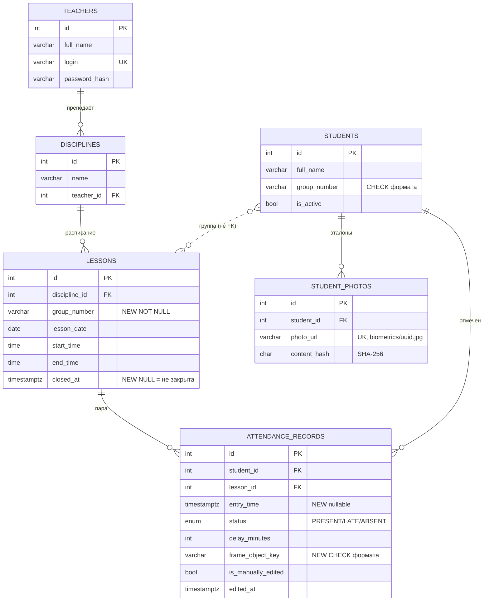

# Сводка критичных правок: ABSENT как запись и закрытие пары

Дата: 16.11.2026. Ветка `devDB`. Источник — фактическая схема БД и прогоны, не память о намерениях.

## 1. Что решено (правила, а не реализация)

- **`ABSENT` — отдельная строка** `attendance_records` со `status='ABSENT'` и `entry_time IS NULL`. Вопрос §9.5 плана 3.2.2 закрыт.
- Состав журнала задаёт **`lessons.group_number`**: группа пары — это те, кто «должен быть». Без этой колонки вычислять отсутствия было не из чего.
- Пару закрывает **одна функция**, у неё два вызывающих: планировщик (сам, по времени) и `POST /attendance/lessons/{lesson_id}/close` (будущая кнопка на фронте). Разойтись они не могут по конструкции.
- Досрочное закрытие **разрешено**: отметка камеры перезапишет `ABSENT`.
- **Поздний вход не пишется** (правило 10.11.2026 сохранено): `outcome=ignored_after_lesson_end`. Такой студент получает `ABSENT` при закрытии пары, но без адреса кадра.
- **`frame_object_key` хранится** в записи и отдаётся в журнале — то, что требовалось для ручного разбора спорных отметок.

## 2. Актуальная ERD (снята с живой БД, не с картинки)

Связь `students.group_number <-> lessons.group_number` - **не внешний ключ**, это совпадение строк-значений, и из неё выводится состав журнала. Пара `ABSENT` существует ровно благодаря этой связи: пока группа не стала частью пары, вычислять отсутствия не из чего.

## 3. Дельта схемы (проверено запросом к живой БД)

Новое: `lessons.group_number varchar(20) NOT NULL`, `lessons.closed_at timestamptz NULL`, `attendance_records.entry_time` → nullable, `attendance_records.frame_object_key varchar(512) NULL`.

Констрейнты, которые обязаны остаться:

| Имя в БД | Правило |
|---|---|
| `uq_lessons_discipline_group_date_start` | ключ пары: дисциплина + группа + дата + начало |
| `ck_lessons_group_number_format` | тот же regex, что у студентов |
| `ck_attendance_records_absent_iff_no_entry_time` | `ABSENT` ⇔ нет времени входа (двусторонний) |
| `ck_attendance_records_frame_key_format` | `frames/<lesson_id>/<uuid4>.jpg` или NULL |
| `ck_attendance_records_frame_key_requires_entry` | кадр только на строке со засчитанным входом |
| `ck_attendance_records_late_iff_delay_present` | не менялся |

Миграция: `alembic/versions/0003_absent_record.py`, применена. Её `downgrade` намеренно падает, если один слот занят двумя группами, — иначе старую уникальность не восстановить без порчи данных.

## 4. Критично в коде: где легче всего всё сломать

1. **`app/services/attendance.py`, условие upsert**: `is_manually_edited IS FALSE AND (entry_time IS NULL OR entry_time > captured_at)`. Ветка `IS NULL` не косметика: `NULL > captured_at` даёт `NULL`, без неё закрытая пара навсегда оставила бы студента отсутствующим, даже когда камера его видела.
2. **`set_` того же upsert включает `frame_object_key`**. Иначе после перезаписи более ранним входом в строке висит снимок от позднего — доказательство не соответствует отметке.
3. **`lesson_end_dt()` — единственный источник границы «пара закончилась»** и для `classify`, и для закрытия. Зона зафиксирована (UTC), контейнеры живут в UTC. Развести эти два места — получить «по классификации идёт, по закрытию кончилась».
4. **`close_lesson()` только вставляет, никогда не обновляет.** Малейшее желание «а заодно пересчитаю» превратит кнопку в ластик поверх реальных посещений.
5. **`app/main.py`, `finally`**: сначала сигнал фону и ожидание задачи, потом `dispose_engine()`. Фон ходит в базу.
6. **`list_lessons` отсортирован полностью** (`…, group_number, id`). Без tie-breaker у разных групп равные дата и время, порядок плывёт от запроса к запросу — поедут и тесты, и «первая пара» на фронте.
7. **`FRAME_KEY_REGEX` объявлена в `db/models.py`**, `storage.py` компилирует из неё валидатор, миграция подставляет в CHECK. Вторую копию не заводить.
8. **В миграциях**: `naming_convention` переписывает только шаблоны с `%(constraint_name)s`. CHECK передавать коротким именем (`absent_iff_no_entry_time`), UNIQUE — полным.
9. **Тесты**: своя группа + дата «завтра» (`make_lesson_group`) и прямой доступ к БД только через `db_call()`. Глобальный `SessionLocal` переживает `asyncio.run` и отдаёт соединение от закрытого цикла, ошибка плавающая.
10. **Сиды**: журнал создаётся только парой своей группы; пар 24 (12 слотов × 2 группы).

## 5. Проверено прогонами

- `pytest` — **54 прогона** (38 интеграционных + 16 юнит-прогонов, одна функция параметризована ×3), два прогона подряд стабильно; сборка сверена `--collect-only`.
- `scripts/smoke.ps1` — расширен: `group_number` во все вставки пар, проверки новых CHECK, `delete` перед каждой негативной проверкой (без него `insert … where not exists` завершается кодом 0, не дойдя до CHECK, — ложный `PASS`).
- Планировщик подтверждён на данных: закрыты ровно истёкшие слоты, идущая в этот момент пара не тронута; ошибки в свежем логе backend отсутствуют.
- Новая конфигурация: `LESSON_CLOSE_ENABLED`, `LESSON_CLOSE_INTERVAL_SECONDS` (в `.env.example` описаны, в `.env` не заданы — работает дефолт `true`).

## 6. Не сделано

- **Эндпоинт ручного редактирования журнала (требование №7)** — задача 3.3.1. Журнал уже отдаёт `is_manually_edited`, `edited_at` и адрес кадра, поэтому UI правки упирается ровно в один отсутствующий эндпоинт.
- RBAC (№9 — заглушка, №10/№11 открыты), ML-контур, фронтенд.
- «Подошёл после конца» и «не подходил вовсе» по-прежнему неразличимы в отчётах (оба — `ABSENT` без кадра). Решение сознательное; при необходимости — менять правила 10.11.2026, а не документацию.
- `Инфа о проекте/ERD.png` **устарела**: на ней схема до 0003 (нет `group_number` и `closed_at`, `entry_time` показан NOT NULL, старый UNIQUE пары). Актуальная - в разделе 2 этого файла.
- Прочая документация не обновлялась по твоему указанию: README (схема, ответ на §9.5, число тестов), Реестр (новая запись на закрытие пары), Устав, `Инструкция. БД, S3 и API.md`, план 3.2.2 (§9.5 → «решено»), `.env` без новых переменных. Из документов правился только `Файлы проекта.md`.
