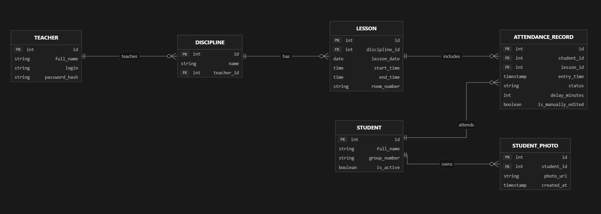

# Назначение документа

Документ описывает, за что отвечает каждый файл репозитория StudentCV на текущем этапе (срезы «База данных и ORM» → «API» → «объектное хранилище»). Структура повторяет логику `README.md`: сначала документация и схема, затем инфраструктура Docker, слой доступа к данным, API приложения, миграции, тесты и вспомогательные скрипты.

Формат описания единый: сначала функция файла, затем ключевые содержательные решения, затем — если файл исполняется — команда запуска.

# Документация проекта

## README.md

Главная точка входа: стек технологий, схема БД и способ поднять окружение.

1. Разделы
    * «Стек» — перечень технологий (Python/FastAPI, PostgreSQL + SQLAlchemy + Alembic, SeaweedFS (S3), Redis + Celery, InsightFace, Vue/Vite)
    * «Схема БД» — шесть таблиц с полями; первичный источник истины для `db/models.py`
    * «Шаблонное расписание времени пар» — семь временных слотов, из которых генерируются пары
    * «Как поднять БД» — команды первого запуска, рабочие команды и способ сделать бэкап
2. Что здесь живёт и почему
    * регулярное выражение формата номера группы — одно из трёх мест, где оно должно совпадать с кодом (см. `db/models.py`)
    * предупреждение про `docker compose down -v` в разделе «Команды»: эта команда уничтожает volume с данными
3. Как связан с кодом
    * при расхождении текста «Схемы БД» и `db/models.py` правятся оба файла, а не один

## Устав.md

Фундамент проекта: цели, области применения, задачи и целевая аудитория.

1. Что задаёт
    * цель и SMART-критерии её достижения
    * области применения, пользователи, функциональные возможности
    * требования к оборудованию, ОС, ПО, информационным данным и надёжности
    * критерии приёмки и вехи плана работ
2. Почему это важно для кода
    * формулировка «95% событий передаются без потерь и дублей» — источник `UNIQUE (student_id, lesson_id)` в `attendance_records`
    * требование «доступ только у авторизованного преподавателя» — причина появления таблицы `teachers` с `password_hash`

## Реестр требований.md

Тринадцать требований с приоритетами и критериями приёмки.

1. Структура каждого требования
    * Primary / Secondary requirements, Design constraints, Assumptions
    * Acceptance Criteria — проверяемые формулировки
2. Что уже закрыто этим срезом
    * требование к хранению данных студентов, дисциплин, пар и журнала — реализовано схемой БД
3. Что изменено руками команды
    * Условие 1 требования про десктоп-поставку переформулировано: фиксируется автономность и один запуск установщика, а не формат `.exe`; внутренняя развёртка (контейнеризация служб хранения) отнесена к зоне ответственности команды. Обоснование — в `План. База данных и ORM.md` §1.1

## План. База данных и ORM.md

Рабочий план среза БД и одновременно реестр принятых решений.

1. Разделы
    * §1 — рамки среза и таблица зафиксированных решений
    * §1.1 — гибридная развёртка: что живёт в контейнерах, что исполняется нативным процессом Windows (CV-инференс из-за GPU и захвата камеры)
    * §2 — инфраструктура compose
    * §3 — модель данных с обоснованием каждого дополнения к README; §3.8 — бэкап и восстановление
    * §4–§6 — слой SQLAlchemy, Alembic, порядок работ по дням
    * §7 — критерии приёмки (проверяемые руками)
    * §8 — таблица рисков и известных питфоллов окружения
    * §9 — открытые вопросы команде
    * §10 — порядок следующих срезов
2. Почему держим отдельно от README
    * README описывает, что должно получиться; этот файл — почему сделано именно так и что ещё не решено

## ERD.png

Схема связей сущностей в графическом виде. Визуальное дополнение к разделу «Схема БД» файла `README.md`; эталон для ревью миграций на глаз.

## Инструкция. БД, S3 и API.md

Рабочая шпаргалка по использованию поднятого окружения — для того, кто не писал этот срез.

1. Разделы
    * «База данных» — как попасть (pgAdmin/psql/с хоста), правило «схему руками не менять», единственно верный порядок изменения схемы через Alembic с досмотркой ревизии
    * «Хранилище объектов» — какие бакеты и чьи ключи, чем смотреть содержимое (у SeaweedFS нет веб-консоли и `mc` в образе), пример записи через `app.services.storage`, бэкап только парой (база + объекты)
    * «API» — заглушка авторизации (заголовок обязателен, токен не проверяется), таблица методов, проверенные curl-примеры, правила классификации проходов
    * две памятки в конце: для frontend-разработчика (источник истины — `/openapi.json`) и для разработчика CV-модуля (креды, формат ключа кадра, порядок «кадр → событие»)
2. Ключевые решения
    * всё, что в инструкции заявлено как проверенное, проверено прогоном на живом стеке (в том числе способ отправки кириллицы из Windows: `--data @file` в UTF-8, а не inline `-d`)
    * документ не дублирует контракт, а отсылает к OpenAPI: схемы полей живут в спеке, а не здесь
3. Чем отличается от README
    * README отвечает «как поднять», этот файл — «как пользоваться уже поднятым»



# Инфраструктура Docker

## compose.yaml

Базовое описание окружения, общее для разработки и поставки.

1. Сервисы
    * `db` — `postgres:16-alpine`; volume `pgdata` для данных, монтирование `docker/postgres/init` в `/docker-entrypoint-initdb.d`, healthcheck через `pg_isready`
    * `storage` — `chrislusf/seaweedfs:4.53`; S3-совместимое хранилище, volume `seadata`, entrypoint из `docker/seaweedfs/entrypoint.sh`; у `db` и `storage` **нет секции `ports:`** в базовом файле — публикацию добавляет целевой override: в dev это `db:5433` и `storage:8333`, в dist — только `storage:8333`
    * `migrate` — сборка из `docker/backend.Dockerfile`, разовый запуск `alembic upgrade head`, профиль `ops`
2. Ключевые решения
    * SeaweedFS вместо MinIO: официальные образы MinIO не загружаются из этой среды (см. §1.1 плана); версия закреплена 4.53, ниже 4.49 нельзя — versioning
    * бакеты biometrics/frames создаёт приложение при старте, а не init-контейнер: versioning обязан включиться до первой записи
    * `POSTGRES_INITDB_ARGS: "--encoding=UTF8 --locale=C"` — без этого кириллический диапазон `[А-ЯЁ]` в CHECK-констрейнте работает нестабильно
    * healthcheck + `depends_on: {condition: service_healthy}` — иначе `pgadmin4`, `backend` и миграции стартуют в пустоту и падают на первом соединении
    * данные в именованном volume, а не в bind-mount: на Windows bind-mount data-каталога PostgreSQL даёт проблемы с правами
3. Команда
    *
    ```
    docker compose up -d
    ```

## compose.override.yaml

Dev-надстройка. Подхватывается автоматически при любом `docker compose up`.

1. Что добавляет
    * проброс `127.0.0.1:5433:5432` для `db` и `127.0.0.1:8333:8333` для `storage` (наружу только loopback)
    * сервис `pgadmin4` — образ `dpage/pgadmin4:8`, `127.0.0.1:5050:80`, volume `pgadmin_data`, read-only монтирование `servers.json`
    * сервис `backend` — uvicorn с `--reload`, профиль по умолчанию, bind-mount `app/`, `db/`, `alembic/`, `tests/`, `pytest.ini` и каталога `./backups:/backups` для дампов
2. Ключевые решения
    * порт 5433 вместо 5432: на хосте Windows обычно стоит локальный PostgreSQL, конфликт портов даёт «Error 10048»
    * `PGADMIN_CONFIG_SERVER_MODE=False` и `MASTER_PASSWORD_REQUIRED=False` — иначе pgAdmin требует мастер-пароль и не показывает прописанный сервер
    * bind-mount исходников нужен, чтобы писать код и миграции без пересборки образа (uvicorn --reload подхватывает `app/`)
    * `./backups` примонтирован в контейнер: дамп хранилища пишется сразу на хост; в /tmp контейнера он терялся при `down -v`
3. Команды
    *
    ```
    docker compose up -d
    docker compose run --rm backend alembic upgrade head
    ```

## compose.dist.yaml

Надстройка поставки на ПК преподавателя. Применяется явно.

1. Что делает
    * `pgadmin4` удаляется через `!reset null` — это инструментарий разработки, не продукт
    * у `db` сбрасываются порты, у `backend` — bind-mount'ы: в прод-развёртке база доступна только по внутренней сети, код берётся из образа
    * `backend` становится службой: образ `studentcv-backend`, `restart: unless-stopped`, наружу `127.0.0.1:8000`
    * `storage` публикует `127.0.0.1:8333` — первое реальное исключение из принципа «наружу только порт приложения»: нативный CV-процесс живёт вне сети compose и ходит в S3-API по loopback; internal-порты weed (9333, 8888) не публикуются ни в одном таргете
    * `AUTH_STUB_ENABLED` переопределяется на `false` — приложение с незакрытым требованием №11 в проде не стартует
    * закомментированная заготовка сервиса `caddy` для раздачи собранного Vite-фронта
2. Ключевые решения
    * порядок файлов даёт «прод по умолчанию безопаснее dev», а не наоборот
    * в комментарии зафиксировано требование пиннить образы по digest: в контуре КГУ выход к Docker Hub может быть закрыт, поэтому образы доставляются tar-архивом и загружаются `docker load`
3. Команда
    *
    ```
    docker compose -f compose.yaml -f compose.dist.yaml up -d
    ```

## docker/backend.Dockerfile

Образ Python-инструмента для миграций и сидов.

1. Содержимое
    * база `python:3.12-slim`, `WORKDIR /app`
    * установка зависимостей из `requirements.txt` отдельным слоем — кэш сборки не сбрасывается при правке кода
    * копирование `db/`, `alembic/`, `alembic.ini`, `app/`; `EXPOSE 8000`, `CMD uvicorn app.main:app`
2. Почему 3.12
    * README задаёт нижнюю границу «3.10+», на хосте 3.13; 3.12 — безопасный общий знаменатель для `asyncpg` и будущих CUDA-сборок PyTorch в CV-слое
3. Что в образ НЕ входит
    * тесты (`tests/`, `pytest.ini`): в прод-образ не кладутся, в dev доступны через bind-mount

## docker/postgres/init/01-extensions.sql

Первоначальная настройка кластера. Исполняется один раз — при первом создании volume `pgdata`.

1. Содержимое
    * `CREATE EXTENSION IF NOT EXISTS pgcrypto` — оставлено про запас: имена файлов биометрии генерирует Python (`uuid4()` в `app/services/storage.py`), приложению расширение пока не нужно
2. Детали, которые нельзя терять
    * файл без shebang и с переводами строк LF: скрипты с CRLF из `/docker-entrypoint-initdb.d` молча не исполняются
    * если extension уже нужен в существующей базе — правка этого файла не поможет, потребуется миграция

## docker/seaweedfs/entrypoint.sh

Entrypoint хранилища: генерирует конфигурацию учётных данных и запускает SeaweedFS.

1. Что делает
    * собирает `s3.json` из переменных окружения в каталог данных (volume) и даёт ему `chmod 600`
    * описывает две учётки: `backend` (полные права, включая Admin - бакеты создаёт приложение) и `cv-writer` (только `Write:frames`/`Read:frames`/`List:frames`)
    * запускает `weed server -s3`: master + volume + filer + S3-гейтвей в одном процессе - наша топология, одна машина, кластер не нужен
2. Ключевые решения
    * секреты не попадают в git: конфиг генерируется при старте из `.env`, а не лежит в репозитории; у SeaweedFS учётки декларативны (`-s3.config` - высший приоритет), отдельного init-контейнера с `mc admin` не требуется
    * scoped-права бакетом: CV-процесс физически не может ни прочитать, ни удалить эталонные фото (проверено живым прогоном - biometrics даёт AccessDenied, frames пишет)
    * `-volume.max=0` - фик реальной поломки, а не косметика: дефолт «8» исчерпался на втором бакете, и PutObject в frames отдавал InternalError («no free volumes left»), при этом biometrics писался нормально
    * `tr -d '\r'` в вызове compose снимает риск CRLF: файл лежит в рабочей папке Windows
3. Как связано с приложением: `S3_BUCKET_FRAMES` из env попадает в `app/services/storage.py::new_frame_key`

## docker/pgadmin/servers.json

Авторегистрация сервера базы в pgAdmin, чтобы не настраивать его руками после каждого пересоздания контейнера.

1. Содержимое
    * сервер `ksu-db`: хост `db` (имя внутри сети compose), порт `5432`, maintenance-база `studentcv`, пользователь `studentcv`
    * пароль — подстановка `${POSTGRES_PASSWORD}` из окружения контейнера, а не литерал
2. Ограничение формата
    * pgAdmin умеет подставлять переменные окружения, но сам файл при этом хранит пароль в открытом виде после подстановки — приемлемо только для dev, потому что pgAdmin исключён из поставки (`compose.dist.yaml`)

## .env.example

Шаблон окружения, который коммитится в репозиторий.

1. Переменные
    * `POSTGRES_USER`, `POSTGRES_PASSWORD`, `POSTGRES_DB` — учётные данные кластера
    * `DATABASE_URL` — DSN вида `postgresql+asyncpg://…@db:5432/studentcv` (хост `db`, не `localhost`)
    * `SQL_ECHO` — лог SQL-запросов; `PGADMIN_DEFAULT_EMAIL`/`PASSWORD` — вход в pgAdmin (только dev)
    * `STORAGE_ADMIN_ACCESS_KEY`/`_SECRET_KEY` — **одна и та же** пара, которую читают entrypoint хранилища (генерирует `s3.json`) и приложение; второй пары не должно быть: расхождение всплывает как AccessDenied в рантайме
    * `CV_ACCESS_KEY`/`CV_SECRET_KEY` — учётка нативного CV-процесса (только бакет `frames`)
    * `S3_ENDPOINT=http://storage:8333` (внутри сети compose; с хоста — `127.0.0.1:8333`), `S3_BUCKET_*`, `S3_REGION`; `S3_ENDPOINT_PUBLIC` закомментирован до среза presigned
    * `AUTH_STUB_LOGIN`/`AUTH_STUB_ENABLED` — заглушка авторизации (требование №11 реальным входом не закрыто)
    * `MIN_PHOTOS`/`MAX_PHOTOS` — правило 1–5 (требование №8)
2. Известные ограничения значений
    * e-mail pgAdmin должен быть в обычном формате: pgAdmin отвергает домены вида `.local`
    * пароли-заглушки обязаны быть заменены перед любым реальным запуском
    * `POSTGRES_PASSWORD` меняется только до инициализации volume `pgdata`

## .env

Локальное окружение с фактическими паролями. Не коммитится (исключён в `.gitignore`), создаётся копированием `.env.example`.

1. Кто читает
    * `env_file` в compose — для контейнеров
2. Питфолл
    * файл должен быть в UTF-8 без BOM: пересохранение через PowerShell `Set-Content` даёт UTF-16, который Docker не читает, и сервисы стартуют с пустыми переменными

## requirements.txt

Зависимости Python-слоя, общий список для образа и локального окружения.

1. Состав
    * `SQLAlchemy==2.0.*`, `asyncpg==0.30.*`, `alembic==1.14.*` — ORM, драйвер, миграции
    * `pydantic==2.*`, `pydantic-settings==2.*`, `python-dotenv==1.*` — модели и настройки
    * `bcrypt==4.*` — хэш пароля преподавателя в сидах
    * `fastapi==0.115.*`, `uvicorn[standard]==0.32.*`, `python-multipart` — API-слой (версии подтверждены сборкой образа)
    * `aioboto3==13.*` — **только асинхронный** S3-клиент: синхронный boto3 в async-обработчике блокирует event loop
    * `pytest`, `pytest-asyncio`, `httpx` — тесты
2. Чего здесь нет намеренно
    * Celery/Redis и InsightFace/PyTorch — следующие срезы; CV-инференс вообще нативный процесс Windows, не этот requirements

## .gitignore

Исключения системы контроля версий.

1. Что не попадает в репозиторий
    * `.env` и `*.local` — секреты
    * `backups/` — дампы базы и хранилища
    * `__pycache__/`, `.venv/`, служебные файлы IDE
    * `_*.py`, `_*.json`, `_*.txt`, `_*.sql`, `_*.bat`, `pull.log`, `manifest.txt`, `tests/_junit.xml` — временные рабочие файлы и отчёты прогонов
2. Почему это важно здесь
    * дампы содержат реальные ФИО студентов, поэтому `backups/` обязан быть исключён до появления живых данных

## .dockerignore

Ограничение контекста сборки для `docker/backend.Dockerfile`.

1. Что отсекается
    * `.git`, `.env`, `backups`, кэш Python, документация
2. Эффект
    * контекст сборки не содержит секретов и не раздувается; при появлении фронта список потребуется расширить на `node_modules` и `frontend/dist`

## .gitattributes

Нормализация переводов строк по типам файлов.

1. Правила
    * `*.sh`, `*.sql`, `*.yml`, `*.yaml`, `*.json`, `*.ini` — LF: эти файлы исполняются внутри Linux-контейнера
    * `*.ps1` — CRLF: запускаются на Windows
2. Что это предотвращает
    * нераспознанные скрипты инициализации в `/docker-entrypoint-initdb.d` и ошибки парсинга в PowerShell

# Слой доступа к данным

## db/__init__.py

Признак Python-пакета. Пустой файл; нужен, чтобы `db.models` и `db.session` импортировались как модули пакета (в том числе из `alembic/env.py` и `python -m db.seeds`).

## db/base.py

Базовый декларативный класс и соглашения об именах ограничений.

1. Содержимое
    * `Base(DeclarativeBase)` с `metadata = MetaData(naming_convention=...)`
    * шаблоны имён для `ix`, `uq`, `ck`, `fk`, `pk`
2. Зачем нужна конвенция
    * имена ограничений предсказуемы: их видно в pgAdmin и в диффах Alembic, вместо `pg_delta_12` и `attendance_records_delay_minutes_check`
3. Важная деталь при правке
    * `ck` шаблон содержит `%(constraint_name)s`, то есть в моделях и миграции имя передаётся **без** префикса; иначе получается задвоение вида `ck_students_ck_students_...`

## db/enums.py

Перечисления предметной области.

1. Содержимое
    * `AttendanceStatus(str, Enum)`: `PRESENT`, `LATE`, `ABSENT`
    * метод `values()` — список имён элементов для нативного PG-enum
2. Почему строковое наследование
    * значение совпадает с именем элемента, поэтому в базе лежат `PRESENT/LATE/ABSENT`, а не `AttendanceStatus.PRESENT`

## db/models.py

Определение шести таблиц — центральный файл среза.

1. Классы и их назначение
    * `TimestampMixin` — `created_at` с `server_default=func.now()`
    * `Teacher` — владелец журналов дисциплин; `login` уникален, хранится `password_hash`
    * `Student` — базовые данные студента; `group_number` с CHECK по формату, `is_active` для мягкого удаления
    * `StudentPhoto` — эталонные фото; хранится ключ объекта `biometrics/<uuid4>.jpg` и `content_hash` (SHA-256 содержимого), `ON DELETE CASCADE`
    * `Discipline` — дисциплина и её преподаватель; `ON DELETE RESTRICT`, чтобы журнал не исчезал вместе с преподавателем
    * `Lesson` — пара: дата плюс время начала и конца; CHECK `end_time > start_time`, UNIQUE на дисциплину, дату и время начала
    * `AttendanceRecord` — запись журнала: время прохода, статус, минуты опоздания, следы ручного редактирования
2. Ключевые решения
    * `GROUP_NUMBER_REGEX = ^\d{2}-[А-ЯЁ]{3,4}[а-яё]{0,3}-\d{2}$` — формат `99-АААаа-99` (`01-ФИИтт-01`, `02-ТИПП-02`); длины заданы диапазоном, потому что в КГУ встречаются и `ФИИтт`, и `ТИПП`. README-вариант отброшен как не покрывающий реальные номера
    * `PHOTO_KEY_REGEX` — жёсткий формат ключа эталона, CHECK `ck_student_photos_photo_key_format`; это константа, а НЕ имя бакета из env: иначе переименование бакета ломало бы вставку невнятной ошибкой констрейнта
    * `UNIQUE (student_id, lesson_id)` в `attendance_records` — критерий «без потерь и дублей» обеспечивается на уровне данных: повторная доставка события обновляет запись, а не создаёт вторую
    * CHECK `(status = 'LATE') = (delay_minutes IS NOT NULL)` и `delay_minutes >= 0` — статус и опоздание не могут противоречить друг другу
    * `entry_time`, `created_at`, `edited_at` — `timestamptz`; `lesson_date` — `Date`, `start_time`/`end_time` — `Time`. Без временной зоны расчёт опоздания поплывёт при переносе сервера
    * `status` — нативный PG-enum с `values_callable`; `create_type` не вызывается вручную
    * `photo_url` уникален — один путь не может быть привязан дважды; правило «от 1 до 5 фото» CHECK'ом не выражается и перенесено в сервисный слой
    * индексы: по `group_number`, частичный по `is_active`, `(discipline_id, lesson_date)`, по `lesson_id`, `student_id`, `entry_time`
    * `pool_pre_ping` и `lazy="selectin"` — чтобы асинхронный слой не падал на ленивой загрузке связей
3. Синхронизация
    * регулярка формата группы существует в трёх местах, которые обязаны совпадать: `db/models.py`, `alembic/versions/0001_init.py`, `README.md`; формат ключа эталона — в двух: `db/models.py`, `alembic/versions/0002_photo_storage.py`
    * ключ **кадра** живёт только в `app/services/storage.py` (генерация и валидация одним модулем); в БД не хранится, CHECK невозможен — специально не дублируется

## db/session.py

Подключение к базе и фабрика асинхронных сессий.

1. Содержимое
    * `engine = create_async_engine(DATABASE_URL, pool_pre_ping=True, pool_size=5, max_overflow=10, echo=SQL_ECHO)`
    * `SessionLocal = async_sessionmaker(..., expire_on_commit=False, autoflush=False)`
    * `get_db()` — генератор с rollback на исключении; эндпоинты зависят от него через `app/dependencies.get_session`, а не напрямую
    * `dispose_engine()` — корректное закрытие пула для lifespan-обработчика
2. Ключевые решения
    * `DATABASE_URL` читается из окружения с fallback на localhost, чтобы модуль импортировался и вне контейнера
    * `pool_pre_ping=True` обязателен: после `restart` контейнера с базой пул остаётся с мёртвыми соединениями, и без pre-ping приложение выглядит зависшим
    * `expire_on_commit=False` — объект можно читать после commit без нового round-trip в базу

## db/seeds.py

Идемпотентные демо-данные для разработки и проверки схемы.

1. Что создаёт
    * одного преподавателя (логин `teacher`, bcrypt-хэш пароля — под него заглушка авторизации)
    * четыре студента с валидными номерами групп
    * дисциплину «Основы программирования»
    * пары по шаблону README на ближайшую учебную неделю: 7 слотов в понедельник, 5 во вторник
    * несколько записей журнала, включая `LATE` с заполненным `delay_minutes`
2. Чего сиды НЕ делают (важно)
    * эталонные фото не заводятся: с среза хранилища фото — это объект в бакете, а не строка; демо-строка указывала бы на несуществующий файл, и CV-модуль терял бы эталон молча. Эталон появляется только через `POST /students/{id}/photos`
2. Как обеспечивает переиспользуемость
    * каждая вставка обёрнута в `get_or_create_*`: сначала `SELECT`, потом `INSERT`, поэтому повторный запуск не даёт `IntegrityError`
    * `commit` в конце одного транзакционного блока, `rollback` при исключении
3. Команда
    *
    ```
    docker compose --profile tools run --rm backend python -m db.seeds
    ```

# API приложения

## app/main.py

Точка входа FastAPI: только сборка приложения, никакой логики и никаких эндпоинтов.

1. Содержимое
    * `lifespan`: проверка конфигурации -> `ensure_buckets()`; при остановке - `dispose_engine()`
    * подключение `health.router` (вне `/api/v1`) и `api_router` (внутри)
2. Ключевые решения
    * бакеты и versioning создаются при старте приложения, а не init-контейнером: versioning обязан включиться **до первой записи** - версии ранее записанных объектов не появляются задним членом
    * ошибка провижининга НЕ валит старт: причины попадают в `app.state.storage_warnings`, а `/healthz` честно показывает `unconfigured`/`down`. Падать на старте означало бы гонку «backend поднялся раньше storage»
    * `validate_settings()` при `AUTH_STUB_ENABLED=false` не поднимает приложение вовсе

## app/dependencies.py

Общие зависимости: сессия БД, текущий преподаватель, пагинация.

1. Содержимое
    * `get_session` - обёртка над `db.session.get_db`, чтобы эндпоинты зависели от app-слоя
    * `bearer_scheme` - `HTTPBearer(auto_error=False, scheme_name="BearerAuth")`: регистрирует схему в OpenAPI и НЕ выдаёт готовый код ошибки (см. детали)
    * `get_current_teacher` - **STUB**: требует заголовок `Authorization` (иначе 401 с `WWW-Authenticate`) и возвращает фиксированного преподавателя из `AUTH_STUB_LOGIN`, не проверяя подлинность токена
    * `pagination_params` - `page`/`limit` (limit ограничен сверху), `Pagination` как frozen dataclass
2. Ключевые детали
    * `auto_error=False` - не косметика: встроенный режим `HTTPBearer` при пустом заголовке отвечает **403** (проверено на FastAPI 0.115), а честный ответ «не представился» - 401. Без этого параметра в контракте был бы описан код, которого API не отдаёт
    * заглушка вешается ОДИН раз на `api_router`, поэтому срез реального входа (сессии/JWT, ЕИОС) меняет только этот файл и config, а не десять обработчиков
    * отсутствие строки `AUTH_STUB_LOGIN` в сидах даёт 500, а не 401: это поломка окружения, а не неудачный вход
    * требование №11 от этого НЕ считается закрытым - оно помечено частично покрытым в `Реестр требований.md`

## app/core/config.py

Настройки из окружения (pydantic-settings). Единственный источник значений: модули `os.getenv` напрямую не читают (кроме `db/session.py`, где DSN нужен Alembic и сидам).

1. Группы
    * приложение: `API_PORT`, `SQL_ECHO`
    * хранилище: `S3_ENDPOINT` (внутри сети - `http://storage:8333`), ключи `STORAGE_ADMIN_*` (та же пара, что читает entrypoint), имена бакетов, `S3_ENDPOINT_PUBLIC` (задел под presigned)
    * авторизация: `AUTH_STUB_LOGIN`, `AUTH_STUB_ENABLED`
    * бизнес-правило 1-5: `MIN_PHOTOS`, `MAX_PHOTOS`
2. Детали
    * `s3_endpoint_public` намеренно None: presigned URL подписывается тем хостом, что указан здесь, и внутренний `http://storage:8333` браузер не достанет - значение выбирается вместе с топологией фронта
    * `region` для SigV4 обязателен, но SeaweedFS его содержательно не интерпретирует

## app/api/router.py

Единственное место, где собираются путь, авторизация и её описание в контракте.

1. Содержимое
    * `APIRouter(prefix="/api/v1", dependencies=[Depends(get_current_teacher)], responses=R401)`; подключение студентов, фото, пар, посещаемости
2. Ключевые решения
    * версия API в одном месте: `/api/v1` -> `/api/v2` правит этот файл, а не каждый эндпоинт
    * `security` и `401` объявлены **один раз здесь**, а не в обработчиках: проверено на живом FastAPI, что и `dependencies`, и `responses` родителя долляются до маршрутов, подключённых через `include_router`, не затирая route-level `responses`. Размазать 401 по обработчикам - способ однажды забыть его на одном эндпоинте, и это дыра в контракте, а не опечатка
    * `/healthz` сюда НЕ входит: это проверка готовности контейнера (без учётных данных) и вне контракта для фронта
    * фото подключаются без подпрефикса: у них два разных пути - вложенный `/students/{id}/photos` (загрузка, список) и плоский `/photos/{id}` (удаление)

## app/api/openapi.py

Обязательства в OpenAPI, которые нельзя вывести из кода молча: набор кодов ошибок и схему авторизации.

1. Зачем появился
    * FastAPI сам описывает только успешный код и автовалидацию тела. Коды, поднятые через `HTTPException`, и требование авторизации в спеке отсутствовали: приёмник событий обещал `201` и `422`, хотя по факту и по тестам отдаёт шесть, а `securitySchemes` не было вовсе - фронт не узнавал, что `/api/v1/*` требуют преподавателя
2. Содержимое
    * `HTTPErrorBody` с `detail`: строка (обычные ошибки), объект (структурированные, напр. нарушение 1-5) **и список** (автовалидация)
    * `R401/R404/R409/R415/R422/R503` - наборы для `responses=`, и `merge()`, который падает на дубле ключа
    * `error422()` через `oneOf` с `HTTPValidationError`: объявленный вручную `422` **перезатирает** схему автовалидации (проверено), поэтому одна только наша модель врала бы про прокидывание `min_length`/лишних полей
    * `ok()` - описание успешного кода, отличного от `status_code` маршрута: у приёмника событий `201` объявлен, а `200` («принято, но не записано по правилу») FastAPI сам бы не описал
3. Чего здесь намеренно нет
    * тела для `204`: у него нет content, объявлять схему - значит вруть в контракте

## app/api/endpoints/health.py

`GET /healthz` - readiness для healthcheck'а контейнера.

1. Что проверяет
    * базу (`SELECT 1`) и хранилище (list-зонд по бакету эталонов)
    * возвращает 503, если база лежит, - иначе healthcheck всегда видел бы 200 и контейнер никогда не стал бы unhealthy
2. Ключевые решения
    * зонд именно `list`, а не `head` несуществующего ключа: по 404 head не отличить «ключа нет» от «бакета нет», а успешный list - это 200 даже для пустого бакета
    * состояния хранилища разделены: `ok` / `unconfigured` (гейтвей жив, бакетов нет) / `down` (не отвечает) - у них разные действия оператора
    * `storage: ok` означает не только «порт отвечает», но и «провижининг прошёл»: иначе первая же загрузка эталона кончилась бы 500 под зелёным healthz

## app/api/endpoints/students.py

Студенты: заведение, поиск, правка, мягкое удаление (требование №9).

1. Эндпоинты
    * `POST /students` (201), `GET /students` с фильтрами `group`/`q`/`is_active` и пагинацией, `GET|PATCH /students/{id}`, `DELETE /students/{id}` (204)
2. Ключевые решения
    * `DELETE` - это `is_active = false`, а не `DELETE FROM`: физическое удаление каскадом стёрло бы записи журнала и сделало бы неправдой уже сданные отчёты
    * неверный формат группы даёт 422 с текстом про формат, а не ошибку CHECK: пользователь CHECK'а не поймёт

## app/api/endpoints/photos.py

Эталонные фото: загрузка, список, удаление (требование №8).

1. Эндпоинты
    * `POST /students/{id}/photos` (multipart, 201), `GET /students/{id}/photos`, `DELETE /photos/{id}` (204)
2. Ключевые решения
    * загрузка идёт через API (проксирование байтов), presigned - отложен до решения топологии фронта
    * принимаются только jpeg/png (415 на остальное); целостность изображения проверяет CV-модуль, API проверяет непустоту
    * ответ списка содержит `status`: `ok` или `below_minimum` (эталонов меньше `MIN_PHOTOS`). Это согласованное «разрешить и предупреждать»: удаление последнего эталона допустимо, но студент без эталонов не распознаётся

## app/api/endpoints/lessons.py

`GET /lessons` с фильтрами по дисциплине и дате - только чтение.

1. Ключевые решения
    * создающей логике здесь не место: расписание ведёт отдельный контур, а парам нужен `discipline_name`, поэтому сервис отдаёт его одним JOIN (иначе N+1 на список пар)

## app/api/endpoints/attendance.py

Приёмник событий от CV-модуля и журнал пары (веха 5, «передача в систему»).

1. Эндпоинты
    * `POST /attendance/events` - `lesson_id`, `student_id`, `captured_at`, `frame_object_key`
    * `GET /attendance/journal?lesson_id=` - журнал пары
2. Коды и смыслы
    * 201 - запись создана или обновлена; 200 - принято, но по правилу ничего не изменилось; исход читается из поля `outcome`, а не из текста
    * 404 - пары нет; 409 - студент не активен; 422 - неверный формат ключа кадра либо кадра нет в бакете; 503 - хранилище недоступно
3. Ключевые решения
    * «пришёл после конца пары» - **не ошибка**, а 200 с `record: null`: данные валидны, мы их сознательно не учитываем, и перекладывать наше правило на клиента 4xx было бы неверно
    * журнал отдаёт и `end_time`: по нему читатель отличает «опоздал» от «пришёл слишком поздно и не учтён»
    * порядок проверок: сначала данные (студент, пара), потом формат ключа, затем хранилище - иначе запрос с несуществующей парой и чужим ключом дал бы 422 вместо честного 404

## app/schemas/

Pydantic-модели: контракт запросов и ответов, на который опишется будущий Vue. OpenAPI (`/docs`, `/openapi.json`) генерируется именно отсюда - расхождение с сервисом дорого, потому что это обещание клиенту.

1. Файлы
    * `student.py` - `StudentCreate/Update/Read/List` (список несёт `total` для пагинации)
    * `photo.py` - `PhotoRead/PhotoList` (в списке `min_photos`/`max_photos` и `status`)
    * `lesson.py` - `LessonRead/LessonList`
    * `attendance.py` - `AttendanceEventCreate`, `AttendanceEventResult`, `Journal`, **`Outcome = Literal[...]`**
    * `health.py` - `HealthResponse` со строгими `database`/`storage` и списком `storage_warnings`
2. Ключевые решения
    * исход события - enum в контракте (Literal), а не `created: bool` и не текст: трёх разных «не изменилось» булев флаг не выражает
    * `record` в ответе nullable - по тому же правилу: отсутствие записи это исход, а не ошибка

## app/services/

Бизнес-логика. HTTP-транспорта не знает - поэтому вызывается и из эндпоинтов, и из тестов, и из будущей Celery-задачи.

### storage.py

Единственная точка, говорящая с S3 (aioboto3, generic S3 - продукт за эндпоинтом не важен).

1. Операции
    * `put_object` / `get_object` / `head_object` / `object_exists` / `delete_object`, `list_probe` (для healthz), `ensure_buckets` (создание + versioning), `compute_content_hash`, `presigned_put_url` (заготовка, из кода не вызывается)
2. Ключевые решения
    * `ObjectNotFound` (404, штатный ответ) принципиально отделён от `StorageError` (авария, 503): смешать их - значит потерять и корректный healthz, и различие «кадра нет» / «хранилище лежит»
    * `try/except` вокруг `yield` в контекст-менеджере клиента **ставить нельзя**: исключение из кода вызывающего слоя при выходе из `async with` прилетает ровно на `yield`, и blanket except превратил бы `ObjectNotFound` в `StorageError`. Именно эту ошибку мы словили на приёмке (healthz показывал `down` при живом хранилище)
    * ключи генерируются здесь же (`new_biometric_key`, `new_frame_key`) и здесь же валидируются (`FRAME_KEY_RE`): два описания одного контракта неизбежно разъезжаются
    * префикс ключа - константа, а не имя бакета из env (CHECK в БД ждёт литерал `biometrics/`)

### students.py

Создание, фильтры, мягкое удаление; проверка формата группы по `GROUP_NUMBER_REGEX` до обращения к БД.

### photos.py

Правило 1-5 и связка «строка ↔ объект».

1. Ключевые решения
    * загрузка: объект в бакете раньше строки; если коммит не удался - объект удаляется, иначе он остался бы осиротевшим навсегда
    * удаление: сначала строка, потом объект (порядок выбран по тяжести остатка: осиротевшие байты - расход, ссылка в никуда - молча потерянный эталон)
    * `verify_objects(session)` - сверка «ключ есть, объекта нет» через head, без скачивания

### attendance.py

Классификация прохода и upsert. Правила 10.11.2026: раньше начала -> `PRESENT`; ровно в начало или позже, но до конца -> `LATE` (ровно в начало = 0 минут); не раньше конца -> **не записываем** (студент остаётся `ABSENT`); при повторе побеждает самое раннее `entry_time`; запись с `is_manually_edited=true` автоматическим событием не трогается.

1. Ключевые решения
    * `classify()` возвращает `None` как сигнал «не писать» - отдельного статуса для «пришёл слишком поздно» в схеме нет
    * границы строятся из `lesson.lesson_date`, а не из дня события: событие с другим днём раньше сравнивалось не с той парой
    * «ранний побеждает» и защита ручной правки - один `ON CONFLICT DO UPDATE ... WHERE` (`entry_time > EXCLUDED.entry_time AND is_manually_edited IS FALSE`); если условие не выполнилось, Postgres даёт 0 строк - это исход, а не ошибка, и различие `kept_earlier_entry`/`kept_manual_edit` снимается по флагу уже существующей строки
    * признак «вставлено или обновлено» берётся из `(xmax = 0)` в `RETURNING` (проверено на живой БД), а не отдельным SELECT: последний дал бы гонку при двух камерах
    * CHECK `(status='LATE') = (delay_minutes IS NOT NULL)` и `delay_minutes >= 0` из среза БД допускают `LATE, 0` - поэтому правила не потребовали миграции

### lessons.py

Чтение пар с именем дисциплины одним запросом; фильтрация по дисциплине и дате, пагинация.

## app/tools/storage_backup.py

Дамп и восстановление **объектов** через S3-API: `dump` / `restore` / `verify`.

1. Что делает
    * `dump`: обходит оба бакета paginator'ом, пишет объекты файлами (`<bucket>/<key с двойным подчёркиванием>`), собирает `manifest.json` с размером и **sha256 каждого объекта** и сохранённым `content_type`
    * `restore`: сверяет sha256 **до** записи, при расхождении останавливается; при отсутствии бакета создаёт его и включает versioning
    * `verify`: только локальная проверка дампа, хранилище не трогает
2. Ключевые решения
    * не `weed filer.backup`: он рассчитан на непрерывную репликацию между кластерами с replication.toml, а симметричной команды импорта нет - нам нужна пара dump/restore в духе pg_dump
    * работает по generic S3: замена продукта за эндпоинтом (в том числе возврат на MinIO) этот инструмент не касается
    * sha256 считаем сами, ETag - нет: у S3-совместимых шлюзов он не всегда равен sha256 (multipart)
    * `content_type` сохраняется, иначе PNG-эталон восстановился бы как `image/jpeg`
    * запуск внутри контейнера backend: там есть aioboto3 и креды; отдельного `mc`/`rclone` на машине преподавателя в поставке нет
3. Команды
    *
    ```
    docker compose exec backend python -m app.tools.storage_backup dump --dir /backups/storage-<stamp>
    ```

# Миграции схемы

## alembic.ini

Конфигурация Alembic.

1. Ключевые настройки
    * `script_location = alembic`, `prepend_sys_path = .`, `file_template = %%(rev)s_%%(slug)s`
    * `sqlalchemy.url` оставлен пустым намеренно: значение подставляется из `DATABASE_URL` в `env.py`, поэтому пароли не попадают в трекаемый файл
2. Что здесь же настраивается
    * уровни логгеров `alembic` и `sqlalchemy`

## alembic/env.py

Окружение Alembic для асинхронного движка.

1. Содержимое
    * вставка корня проекта в `sys.path`, импорт `db.base.Base` и `db.models` для наполнения метаданных
    * `target_metadata = Base.metadata`, `compare_type=True`, `render_as_batch=False`
    * `run_async_migrations()` через `create_async_engine` + `connection.run_sync(do_run_migrations)`
    * offline-режим для генерации SQL без подключения к базе
2. Ключевые решения
    * отсутствие `DATABASE_URL` считается ошибкой конфигурации, а не сигналом взять значение по умолчанию: иначе миграция уедет в чужую базу
    * `render_as_batch=False` — PostgreSQL умеет менять колонки без пересоздания таблицы
3. Команды
    *
    ```
    docker compose --profile tools run --rm backend alembic current
    docker compose --profile tools run --rm backend alembic check
    ```

## alembic/script.py.mako

Шаблон нового файла ревизии, по которому Alembic генерирует `alembic revision`.

1. Содержимое
    * заголовок с revision id, down revision и датой
    * тела `upgrade()` / `downgrade()`
    * строка `${imports if imports else ""}` — сюда autogenerate подкладывает импорты, включая `postgresql.ENUM`

## alembic/versions/0001_init.py

Первая ревизия: создаёт всю схему.

1. Объекты
    * тип `attendance_status` с метками `PRESENT`, `LATE`, `ABSENT`
    * шесть таблиц в порядке зависимостей: `teachers` → `students` → `student_photos` → `disciplines` → `lessons` → `attendance_records`
    * CHECK-констрейнты формата группы, соотношения статуса и опоздания, неотрицательного опоздания и порядка времени пары
    * UNIQUE на `(student_id, lesson_id)` и на `(discipline_id, lesson_date, start_time)`
    * индексы, включая частичный `ix_students_is_active`
2. Ключевые решения
    * enum-тип создаёт хук SQLAlchemy при `create_table` (`create_type=True`); отдельный ручной `create()` даёт `DuplicateObjectError`
    * имена CHECK передаются без префикса `ck_` — префикс добавляет `naming_convention`
    * `downgrade()` удаляет объекты в обратном порядке и в конце роняет тип enum
3. Правило команды
    * схема меняется моделью плюс миграцией; правки таблиц руками в pgAdmin запрещены, иначе `--autogenerate` начнёт генерировать обратные `DROP`
4. Команды
    *
    ```
    docker compose --profile tools run --rm backend alembic upgrade head
    docker compose --profile tools run --rm backend alembic downgrade base
    ```

## alembic/versions/0002_photo_storage.py

Вторая ревизия: схема под объектное хранилище — продукты не меняет, меняет контракт ключей.

1. Объекты
    * `content_hash CHAR(64) NULL` + индекс `ix_student_photos_content_hash` в `student_photos`
    * CHECK `photo_key_format` — ключ обязан быть `biometrics/<uuid4>.jpg`
    * `upgrade()` сначала переименовывает невалидные ключи демо-строк в uuid, потом добавляет CHECK, и падает `RuntimeError`, если после переименования остались невалидные — вместо тихого пропуска мусора
2. Ключевые решения
    * `content_hash` nullable: демо-строки среза БД хэша не имеют, `NOT NULL` по живым данным требовал бы backfill — обязательность решится отдельной миграцией
    * `downgrade()` передаёт имя CHECK **без** префикса `ck_`: `naming_convention` оборачивает и `drop_constraint`, иначе задвоение (`ck_student_photos_ck_student_photos_...`) — этот питфолл уже подтверждался прогоном
3. Команда
    *
    ```
    docker compose run --rm backend alembic upgrade head
    ```

## alembic/versions/.gitkeep

Пустышка, сохранявшая каталог `versions/` до появления первых ревизий; сейчас каталог не пуст, файл оставлен как маркер.

# Вспомогательные скрипты

## scripts/backup.ps1

Дамп базы в собственный формат PostgreSQL с ротацией.

1. Что делает
    * читает `POSTGRES_USER` и `POSTGRES_DB` из `.env`
    * выполняет `pg_dump -Fc` **внутри контейнера** в `/tmp/backup.dump`, затем выносит файл наружу через `docker compose cp`
    * складывает в `backups/studentcv-<timestamp>.dump`, оставляет 10 последних (`-Keep`)
2. Ключевые решения
    * перенаправление `pg_dump > file` через `cmd` портит бинарные байты — поэтому дамп пишется в контейнере и копируется
    * файл проверяется на минимальный размер и на магический заголовок `PGDMP`; дамп без проверки — это гипотеза, а не бэкап
    * stderr гасится на время вызовов docker, потому что `docker compose cp` пишет прогресс в stderr, а `$ErrorActionPreference='Stop'` превратил бы успех в ошибку
    * только ASCII: не-ASCII символы в `.ps1` ломают парсинг на этой машине
3. Команда
    *
    ```
    powershell -ExecutionPolicy Bypass -File scripts\backup.ps1
    ```

## scripts/restore.ps1

Восстановление базы из дампа, созданного `backup.ps1`.

1. Что делает
    * без параметра `-File` берёт самый свежий файл из `backups/`
    * копирует дамп в контейнер и выполняет `pg_restore --clean --if-exists --no-owner`
    * после восстановления выводит количество студентов как быструю проверку
2. Ключевые решения
    * дамп передаётся файлом внутри контейнера: пайп `type dump | pg_restore` через `cmd` обрывается на битых байтах
    * `--clean --if-exists` позволяет восстанавливать в непустую базу без ручной зачистки
3. Команда
    *
    ```
    powershell -ExecutionPolicy Bypass -File scripts\restore.ps1 -File backups\studentcv-20261108-181248.dump
    ```

## scripts/smoke.ps1

Приёмочные проверки схемы: констрейнты, уникальность, каскадное удаление.

1. Проверяемое
    * вставка студента с валидным номером группы проходит
    * строчные буквы в номере группы отвергаются CHECK'ом
    * номер с двумя заглавными буквами отвергается
    * `LATE` без `delay_minutes` отвергается, `LATE` с `delay_minutes` проходит
    * повторная посещаемость по той же паре и студенту отвергается UNIQUE'ом
    * удаление студента каскадно удаляет его фото
    * пара с `end_time <= start_time` отвергается CHECK'ом
    * ключ фото неверной формы (не `biometrics/<uuid4>.jpg`) отвергается CHECK'ом формата, валидный uuid проходит
2. Ключевые решения
    * кириллица собирается из кодов символов (`[char]0x0424` и т.д.), потому что файл обязан оставаться ASCII
    * SQL копируется в контейнер через `docker compose cp`, результат пишется `psql` в файл внутри контейнера и забирается обратно — пайп через `cmd` искажал бы байты
    * проверки на отказ работают по коду возврата `psql -v ON_ERROR_STOP=1` и по совпадению имени констрейнта в тексте ошибки
    * тесты самодостаточны: создают собственную дисциплину и пару, поэтому не зависят от запуска сидов
3. Команда
    *
    ```
    powershell -ExecutionPolicy Bypass -File scripts\smoke.ps1
    ```

## scripts/backup_storage.ps1

Дамп объектов хранилища в `./backups/storage-<stamp>/` + проверка + ротация.

1. Что делает
    * вызывает `app.tools.storage_backup dump` внутри контейнера backend; дамп пишется сразу в `/backups` - bind-mount хостового `./backups`
    * проверяет, что `manifest.json` читается и каждый объект из него лежит на диске; хранит 5 последних дампов (`-Keep`)
2. Ключевые решения
    * дамп обязан попадать на хост, а не в `/tmp` контейнера: один дамп мы потеряли именно так - `docker compose down -v` унёс его вместе с контейнером
    * скрипт строго ASCII; stderr вызовов docker гасится, иначе `$ErrorActionPreference='Stop'` превратил бы успешный вызов в ошибку
    * это **половина** резервной копии: ключи фото живут в `student_photos`, поэтому дамп базы нужен в паре с этим дампом
3. Команда
    *
    ```
    powershell -ExecutionPolicy Bypass -File scripts\backup_storage.ps1
    ```

## scripts/restore_storage.ps1

Восстановление объектов из дампа (по умолчанию самого свежего) и режим проверки.

1. Что делает
    * `restore` - раскладывает объекты в бакеты, предварительно сверив sha256 каждого
    * `-VerifyOnly` - только проверка дампа, хранилище не трогается
2. Ключевые решения
    * проверка хэшей встроена в сам `restore`: дамп, который молча restores битые байты, хуже отсутствующего
    * после восстановления отдельной подсказкой возвращается сверка `verify_objects`: окончательное слово о том, какие ключи «настоящие», остаётся за базой
3. Команды
    *
    ```
    powershell -ExecutionPolicy Bypass -File scripts\restore_storage.ps1
    powershell -ExecutionPolicy Bypass -File scripts\restore_storage.ps1 -VerifyOnly
    ```

# Тесты

## pytest.ini

Конфигурация pytest.

1. Ключевые настройки
    * `pythonpath = .` - тесты импортируют приложение как пакет (`from app.main import ...`), как это делает и uvicorn; лечится именно здесь, а не хак-конфестом
    * `testpaths = tests`, `asyncio_mode = strict`
2. Как связано с образом
    * тесты в прод-образ не копируются; в dev доступны через bind-mount вместе с этим файлом
3. Команда
    *
    ```
    docker compose exec backend python -m pytest tests -q
    ```

## tests/unit/test_attendance_delay.py

Спецификация правил классификации - независимо от HTTP и хранилища.

1. Покрытие: раньше начала, ровно начало (`LATE, 0`), 31 секунда -> 1 минута (ceil, а не truncate), ровно час, 8:59 и 9:59 внутри пары, «не раньше конца» -> `None`, наивное время (трактуется как UTC), инвариант `LATE <=> delay NOT NULL` и `delay >= 0`
2. Важно
    * тест построен от **даты пары**, а не от «сегодня»: иначе событие попадает в другой день, границы считаются по `lesson_date`, и любое опоздание стало бы `PRESENT` - тест молча проверял бы не то
    * `test_late_at_start_time` - инверсия прежнего `test_present_at_start_time`, который закреплял наше допущение вместо правила заказчика

## tests/integration/test_api_flow.py

Интеграционные тесты против живого compose-стека: реальный PostgreSQL, реальный SeaweedFS, реальные объекты в бакетах - без моков.

1. Покрытие
    * авторизация: без `Authorization` - 401 с `WWW-Authenticate`, `/healthz` при этом остаётся открытым
    * healthz (оба источника живы), студенты (создание/поиск/фильтры/мягкое удаление)
    * фото: объект реально появляется в `biometrics`, `content_hash` совпадает с sha256 байт, 6-е фото -> 422, удаление убирает и строку, и объект, чужой тип контента -> 415, нет студента -> 404
    * посещаемость: `LATE` с расчётом минут, `LATE 0` при входе ровно в начало, ранний вход перебивает поздний (а поздний - ранний нет), вход после конца пары -> 200 с `record: null` и пустым журналом, дублей нет, ручная правка не перезаписывается, неверный формат ключа отличается от отсутствующего кадра, журнал несёт имя дисциплины и окно пары
2. Ключевые решения
    * `client` шлёт `Authorization: Bearer ...`: заголовок стал обязателен, и без него падал бы весь набор, а не один тест
    * кадры тесты кладут в `frames` сами (креды бэкенда), потому что в реальности это делает нативный CV-процесс: так проверяются и контракт ключей, и доступность хранилища из контейнера backend
    * `unique_group()` собирает номер из буквенной части, а не из hex-суффикса: прежняя склейка `f"0{unique_suffix()[-1]}-..."` в ~37% случаев давала невалидную группу (`0a-...`), и тест фильтра по группе молча ничего не проверял
    * хост `captured_for` строит время от **даты пары**: с авторитетом `lesson_date` событие от «сегодня» попало бы в другой день и все опоздания стали бы неверными
    * запуск изнутри контейнера backend: uvicorn уже слушает `localhost:8000` в его netns, `BASE_URL` - единственная настройка снаружи
3. Команда
    *
    ```
    docker compose exec backend python -m pytest tests/integration -q
    ```

# Артефакты, которых нет в репозитории

## backups/

Каталог дампов, исключён из версионного контроля: содержит реальные ФИО студентов.

1. Состав
    * `studentcv-<timestamp>.dump` — дамп базы (формат `-Fc`)
    * `storage-<timestamp>/` — дамп хранилища: файлы объектов по бакетам + `manifest.json` с sha256 каждого
2. Правила обращения
    * появляются после первых запусков `backup.ps1` / `backup_storage.ps1`; пустой каталог — норма для свежей копии репозитория
    * каталог примонтирован в контейнер backend (`./backups:/backups`), поэтому дамп хранилища пишется сразу на хост — в `/tmp` контейнера он терялся при `down -v`, и один дамп мы так потеряли

# Что ещё не реализовано

Разделы зафиксированы в `План. База данных и ORM.md` §10 и отсутствуют в коде намеренно:

1. Приложение — реализовано этим срезом
    * FastAPI, эндпоинты, `/healthz`, студенты/фото/журнал — см. раздел «API приложения»
2. Хранилище и очереди
    * объектное хранилище реализовано (SeaweedFS, generic S3); из планов остались Redis, Celery-воркеры, CV-инференс и presigned-загрузка (заготовка `presigned_put_url` в `app/services/storage.py` не вызывается)
3. Поставка
    * инсталлятор и запускатор, `docker save`/`docker load` tar-архивом, сервис `caddy`
4. Сервисный слой данных
    * правило «от 1 до 5 фото» и классификация проходов (правила 10.11.2026) реализованы; не хватает эндпоинта ручного редактирования журнала (требование №7) — сейчас `is_manually_edited` может поставить только прямая правка БД
5. Открытые вопросы
    * справочник временных пар, лицензия Docker Desktop, форма поставки, набор полей преподавателя, неразличимость «не пришёл» / «пришёл после конца пары» в отчётах, временная зона расписания, TTL кадров в бакете frames
