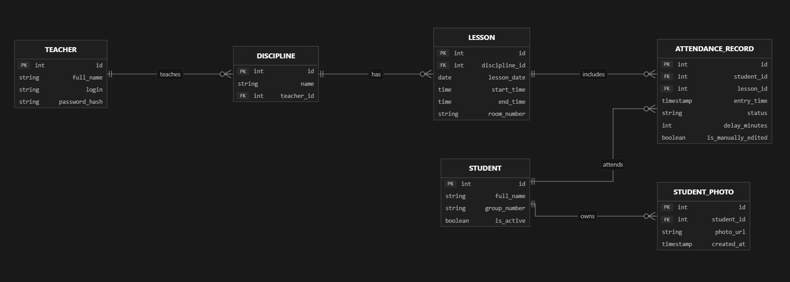

# Назначение документа

Документ описывает, за что отвечает каждый файл репозитория StudentCV на текущем этапе (срез «База данных и ORM»). Структура повторяет логику `README.md`: сначала документация и схема, затем инфраструктура Docker, слой доступа к данным, миграции и вспомогательные скрипты.

Формат описания единый: сначала функция файла, затем ключевые содержательные решения, затем — если файл исполняется — команда запуска.

# Документация проекта

## README.md

Главная точка входа: стек технологий, схема БД и способ поднять окружение.

1. Разделы
    * «Стек» — перечень технологий (Python/FastAPI, PostgreSQL + SQLAlchemy + Alembic, MinIO, Redis + Celery, InsightFace, Vue/Vite)
    * «Схема БД» — шесть таблиц с полями; первичный источник истины для `db/models.py`
    * «Шаблонное расписание времени пар» — семь временных слотов, из которых генерируются пары
    * «Как поднять БД» — команды первого запуска, рабочие команды и способ сделать бэкап
2. Что здесь живёт и почему
    * регулярное выражение формата номера группы — одно из трёх мест, где оно должно совпадать с кодом (см. `db/models.py`)
    * предупреждение про `docker compose down -v` в разделе «Команды»: эта команда уничтожает volume с данными
3. Как связан с кодом
    * при расхождении текста «Схемы БД» и `db/models.py` правятся оба файла, а не один

## Устав.md

Фундамент проекта: цели, области применения, задачи и целевая аудитория.

1. Что задаёт
    * цель и SMART-критерии её достижения
    * области применения, пользователи, функциональные возможности
    * требования к оборудованию, ОС, ПО, информационным данным и надёжности
    * критерии приёмки и вехи плана работ
2. Почему это важно для кода
    * формулировка «95% событий передаются без потерь и дублей» — источник `UNIQUE (student_id, lesson_id)` в `attendance_records`
    * требование «доступ только у авторизованного преподавателя» — причина появления таблицы `teachers` с `password_hash`

## Реестр требований.md

Тринадцать требований с приоритетами и критериями приёмки.

1. Структура каждого требования
    * Primary / Secondary requirements, Design constraints, Assumptions
    * Acceptance Criteria — проверяемые формулировки
2. Что уже закрыто этим срезом
    * требование к хранению данных студентов, дисциплин, пар и журнала — реализовано схемой БД
3. Что изменено руками команды
    * Условие 1 требования про десктоп-поставку переформулировано: фиксируется автономность и один запуск установщика, а не формат `.exe`; внутренняя развёртка (контейнеризация служб хранения) отнесена к зоне ответственности команды. Обоснование — в `План. База данных и ORM.md` §1.1

## План. База данных и ORM.md

Рабочий план среза БД и одновременно реестр принятых решений.

1. Разделы
    * §1 — рамки среза и таблица зафиксированных решений
    * §1.1 — гибридная развёртка: что живёт в контейнерах, что исполняется нативным процессом Windows (CV-инференс из-за GPU и захвата камеры)
    * §2 — инфраструктура compose
    * §3 — модель данных с обоснованием каждого дополнения к README; §3.8 — бэкап и восстановление
    * §4–§6 — слой SQLAlchemy, Alembic, порядок работ по дням
    * §7 — критерии приёмки (проверяемые руками)
    * §8 — таблица рисков и известных питфоллов окружения
    * §9 — открытые вопросы команде
    * §10 — порядок следующих срезов
2. Почему держим отдельно от README
    * README описывает, что должно получиться; этот файл — почему сделано именно так и что ещё не решено

## ERD.png

Схема связей сущностей в графическом виде. Визуальное дополнение к разделу «Схема БД» файла `README.md`; эталон для ревью миграций на глаз.



# Инфраструктура Docker

## compose.yaml

Базовое описание окружения, общее для разработки и поставки.

1. Сервисы
    * `db` — `postgres:16-alpine`; volume `pgdata` для данных, монтирование `docker/postgres/init` в `/docker-entrypoint-initdb.d`, healthcheck через `pg_isready`
    * `migrate` — сборка из `docker/backend.Dockerfile`, разовый запуск `alembic upgrade head`, профиль `ops`
2. Ключевые решения
    * у `db` **нет секции `ports:`** — наружу база не публикуется никогда; проброс появляется только в dev-override
    * `POSTGRES_INITDB_ARGS: "--encoding=UTF8 --locale=C"` — без этого кириллический диапазон `[А-ЯЁ]` в CHECK-констрейнте работает нестабильно
    * healthcheck + `depends_on: {condition: service_healthy}` — иначе `pgadmin4` и миграции стартуют в пустоту и падают на первом соединении
    * данные в именованном volume, а не в bind-mount: на Windows bind-mount data-каталога PostgreSQL даёт проблемы с правами
3. Команда
    *
    ```
    docker compose up -d
    ```

## compose.override.yaml

Dev-надстройка. Подхватывается автоматически при любом `docker compose up`.

1. Что добавляет
    * проброс `127.0.0.1:5433:5432` для `db`
    * сервис `pgadmin4` — образ `dpage/pgadmin4:8`, `127.0.0.1:5050:80`, volume `pgadmin_data`, read-only монтирование `servers.json`
    * сервис `backend` — инструмент для Alembic и сидов, профиль `tools`, bind-mount `db/`, `alembic/`, `alembic.ini`
2. Ключевые решения
    * порт 5433 вместо 5432: на хосте Windows обычно стоит локальный PostgreSQL, конфликт портов даёт «Error 10048»
    * `PGADMIN_CONFIG_SERVER_MODE=False` и `MASTER_PASSWORD_REQUIRED=False` — иначе pgAdmin требует мастер-пароль и не показывает прописанный сервер
    * bind-mount исходников нужен, чтобы писать миграции без пересборки образа
    * `command: sleep infinity` — контейнер держать живым, команды в него запускать через `run`/`exec`
3. Команды
    *
    ```
    docker compose up -d
    docker compose --profile tools run --rm backend alembic upgrade head
    ```

## compose.dist.yaml

Надстройка поставки на ПК преподавателя. Применяется явно.

1. Что делает
    * `pgadmin4` и `backend` удаляются через `!reset null` — это инструментарий разработки, не продукт
    * у `db` сбрасываются порты: в прод-развёртке база доступна только по внутренней сети
    * закомментированная заготовка сервиса `caddy` для раздачи собранного Vite-фронта
2. Ключевые решения
    * порядок файлов даёт «прод по умолчанию безопаснее dev», а не наоборот
    * в комментарии зафиксировано требование пиннить образы по digest: в контуре КГУ выход к Docker Hub может быть закрыт, поэтому образы доставляются tar-архивом и загружаются `docker load`
3. Команда
    *
    ```
    docker compose -f compose.yaml -f compose.dist.yaml up -d
    ```

## docker/backend.Dockerfile

Образ Python-инструмента для миграций и сидов.

1. Содержимое
    * база `python:3.12-slim`, `WORKDIR /app`
    * установка зависимостей из `requirements.txt` отдельным слоем — кэш сборки не сбрасывается при правке кода
    * копирование `db/`, `alembic/`, `alembic.ini`
2. Почему 3.12
    * README задаёт нижнюю границу «3.10+», на хосте 3.13; 3.12 — безопасный общий знаменатель для `asyncpg` и будущих CUDA-сборок PyTorch в CV-слое
3. Статус
    * в этом срезе это не сервис приложения, а инструмент: FastAPI появится следующим срезом

## docker/postgres/init/01-extensions.sql

Первоначальная настройка кластера. Исполняется один раз — при первом создании volume `pgdata`.

1. Содержимое
    * `CREATE EXTENSION IF NOT EXISTS pgcrypto` — нужен `gen_random_uuid()` для имён файлов биометрии в MinIO
2. Детали, которые нельзя терять
    * файл без shebang и с переводами строк LF: скрипты с CRLF из `/docker-entrypoint-initdb.d` молча не исполняются
    * если extension уже нужен в существующей базе — правка этого файла не поможет, потребуется миграция

## docker/pgadmin/servers.json

Авторегистрация сервера базы в pgAdmin, чтобы не настраивать его руками после каждого пересоздания контейнера.

1. Содержимое
    * сервер `ksu-db`: хост `db` (имя внутри сети compose), порт `5432`, maintenance-база `studentcv`, пользователь `studentcv`
    * пароль — подстановка `${POSTGRES_PASSWORD}` из окружения контейнера, а не литерал
2. Ограничение формата
    * pgAdmin умеет подставлять переменные окружения, но сам файл при этом хранит пароль в открытом виде после подстановки — приемлемо только для dev, потому что pgAdmin исключён из поставки (`compose.dist.yaml`)

## .env.example

Шаблон окружения, который коммитится в репозиторий.

1. Переменные
    * `POSTGRES_USER`, `POSTGRES_PASSWORD`, `POSTGRES_DB` — учётные данные кластера
    * `DATABASE_URL` — DSN вида `postgresql+asyncpg://…@db:5432/studentcv` (хост `db`, не `localhost`)
    * `SQL_ECHO` — лог SQL-запросов
    * `PGADMIN_DEFAULT_EMAIL`, `PGADMIN_DEFAULT_PASSWORD` — вход в pgAdmin
2. Известные ограничения значений
    * e-mail должен быть в обычном формате: pgAdmin отвергает домены вида `.local`
    * значения паролей-заглушек обязаны быть заменены перед любым реальным запуском

## .env

Локальное окружение с фактическими паролями. Не коммитится (исключён в `.gitignore`), создаётся копированием `.env.example`.

1. Кто читает
    * `env_file` в compose — для контейнеров
2. Питфолл
    * файл должен быть в UTF-8 без BOM: пересохранение через PowerShell `Set-Content` даёт UTF-16, который Docker не читает, и сервисы стартуют с пустыми переменными

## requirements.txt

Зависимости Python-слоя, общий список для образа и локального окружения.

1. Состав
    * `SQLAlchemy==2.0.*` — ORM
    * `asyncpg==0.30.*` — асинхронный драйвер PostgreSQL
    * `alembic==1.14.*` — миграции
    * `pydantic==2.*` — модели данных для будущего API-слоя
    * `python-dotenv==1.*` — загрузка `.env`
    * `bcrypt==4.*` — хэш пароля преподавателя в сидах
2. Статус
    * FastAPI, MinIO-клиент, Celery, InsightFace здесь отсутствуют намеренно: они относятся к следующим срезам

## .gitignore

Исключения системы контроля версий.

1. Что не попадает в репозиторий
    * `.env` и `*.local` — секреты
    * `backups/`, `pgdata/` — данные и дампы
    * `__pycache__/`, `.venv/`, служебные файлы IDE
2. Почему это важно здесь
    * дампы содержат реальные ФИО студентов, поэтому `backups/` обязан быть исключён до появления живых данных

## .dockerignore

Ограничение контекста сборки для `docker/backend.Dockerfile`.

1. Что отсекается
    * `.git`, `.env`, `backups`, кэш Python, документация
2. Эффект
    * контекст сборки не содержит секретов и не раздувается; при добавлении FastAPI список потребуется расширить на `node_modules` и фронт

## .gitattributes

Нормализация переводов строк по типам файлов.

1. Правила
    * `*.sh`, `*.sql`, `*.yml`, `*.yaml`, `*.json`, `*.ini` — LF: эти файлы исполняются внутри Linux-контейнера
    * `*.ps1` — CRLF: запускаются на Windows
2. Что это предотвращает
    * нераспознанные скрипты инициализации в `/docker-entrypoint-initdb.d` и ошибки парсинга в PowerShell

# Слой доступа к данным

## db/__init__.py

Признак Python-пакета. Пустой файл; нужен, чтобы `db.models` и `db.session` импортировались как модули пакета (в том числе из `alembic/env.py` и `python -m db.seeds`).

## db/base.py

Базовый декларативный класс и соглашения об именах ограничений.

1. Содержимое
    * `Base(DeclarativeBase)` с `metadata = MetaData(naming_convention=...)`
    * шаблоны имён для `ix`, `uq`, `ck`, `fk`, `pk`
2. Зачем нужна конвенция
    * имена ограничений предсказуемы: их видно в pgAdmin и в диффах Alembic, вместо `pg_delta_12` и `attendance_records_delay_minutes_check`
3. Важная деталь при правке
    * `ck` шаблон содержит `%(constraint_name)s`, то есть в моделях и миграции имя передаётся **без** префикса; иначе получается задвоение вида `ck_students_ck_students_...`

## db/enums.py

Перечисления предметной области.

1. Содержимое
    * `AttendanceStatus(str, Enum)`: `PRESENT`, `LATE`, `ABSENT`
    * метод `values()` — список имён элементов для нативного PG-enum
2. Почему строковое наследование
    * значение совпадает с именем элемента, поэтому в базе лежат `PRESENT/LATE/ABSENT`, а не `AttendanceStatus.PRESENT`

## db/models.py

Определение шести таблиц — центральный файл среза.

1. Классы и их назначение
    * `TimestampMixin` — `created_at` с `server_default=func.now()`
    * `Teacher` — владелец журналов дисциплин; `login` уникален, хранится `password_hash`
    * `Student` — базовые данные студента; `group_number` с CHECK по формату, `is_active` для мягкого удаления
    * `StudentPhoto` — эталонные фото; хранится путь в S3/MinIO, `ON DELETE CASCADE`
    * `Discipline` — дисциплина и её преподаватель; `ON DELETE RESTRICT`, чтобы журнал не исчезал вместе с преподавателем
    * `Lesson` — пара: дата плюс время начала и конца; CHECK `end_time > start_time`, UNIQUE на дисциплину, дату и время начала
    * `AttendanceRecord` — запись журнала: время прохода, статус, минуты опоздания, следы ручного редактирования
2. Ключевые решения
    * `GROUP_NUMBER_REGEX = ^\d{2}-[А-ЯЁ]{3,4}[а-яё]{0,3}-\d{2}$` — формат `99-АААаа-99` (`01-ФИИтт-01`, `02-ТИПП-02`); длины заданы диапазоном, потому что в КГУ встречаются и `ФИИтт`, и `ТИПП`. README-вариант отброшен как не покрывающий реальные номера
    * `UNIQUE (student_id, lesson_id)` в `attendance_records` — критерий «без потерь и дублей» обеспечивается на уровне данных: повторная доставка события обновляет запись, а не создаёт вторую
    * CHECK `(status = 'LATE') = (delay_minutes IS NOT NULL)` и `delay_minutes >= 0` — статус и опоздание не могут противоречить друг другу
    * `entry_time`, `created_at`, `edited_at` — `timestamptz`; `lesson_date` — `Date`, `start_time`/`end_time` — `Time`. Без временной зоны расчёт опоздания поплывёт при переносе сервера
    * `status` — нативный PG-enum с `values_callable`; `create_type` не вызывается вручную
    * `photo_url` уникален — один путь не может быть привязан дважды; правило «от 1 до 5 фото» CHECK'ом не выражается и перенесено в сервисный слой
    * индексы: по `group_number`, частичный по `is_active`, `(discipline_id, lesson_date)`, по `lesson_id`, `student_id`, `entry_time`
    * `pool_pre_ping` и `lazy="selectin"` — чтобы асинхронный слой не падал на ленивой загрузке связей
3. Синхронизация
    * регулярка формата группы существует в трёх местах, которые обязаны совпадать: `db/models.py`, `alembic/versions/0001_init.py`, `README.md`

## db/session.py

Подключение к базе и фабрика асинхронных сессий.

1. Содержимое
    * `engine = create_async_engine(DATABASE_URL, pool_pre_ping=True, pool_size=5, max_overflow=10, echo=SQL_ECHO)`
    * `SessionLocal = async_sessionmaker(..., expire_on_commit=False, autoflush=False)`
    * `get_db()` — генератор с rollback на исключении (зависимость для будущего FastAPI)
    * `dispose_engine()` — корректное закрытие пула для lifespan-обработчика
2. Ключевые решения
    * `DATABASE_URL` читается из окружения с fallback на localhost, чтобы модуль импортировался и вне контейнера
    * `pool_pre_ping=True` обязателен: после `restart` контейнера с базой пул остаётся с мёртвыми соединениями, и без pre-ping приложение выглядит зависшим
    * `expire_on_commit=False` — объект можно читать после commit без нового round-trip в базу

## db/seeds.py

Идемпотентные демо-данные для разработки и проверки схемы.

1. Что создаёт
    * одного преподавателя (логин `teacher`, bcrypt-хэш пароля)
    * четыре студента с валидными номерами групп
    * дисциплину «Основы программирования»
    * пары по шаблону README на учебную неделю: 7 слотов в понедельник, 5 во вторник
    * несколько записей журнала, включая `LATE` с заполненным `delay_minutes`
    * одно тестовое фото с путём в biometrics
2. Как обеспечивает переиспользуемость
    * каждая вставка обёрнута в `get_or_create_*`: сначала `SELECT`, потом `INSERT`, поэтому повторный запуск не даёт `IntegrityError`
    * `commit` в конце одного транзакционного блока, `rollback` при исключении
3. Команда
    *
    ```
    docker compose --profile tools run --rm backend python -m db.seeds
    ```

# Миграции схемы

## alembic.ini

Конфигурация Alembic.

1. Ключевые настройки
    * `script_location = alembic`, `prepend_sys_path = .`, `file_template = %%(rev)s_%%(slug)s`
    * `sqlalchemy.url` оставлен пустым намеренно: значение подставляется из `DATABASE_URL` в `env.py`, поэтому пароли не попадают в трекаемый файл
2. Что здесь же настраивается
    * уровни логгеров `alembic` и `sqlalchemy`

## alembic/env.py

Окружение Alembic для асинхронного движка.

1. Содержимое
    * вставка корня проекта в `sys.path`, импорт `db.base.Base` и `db.models` для наполнения метаданных
    * `target_metadata = Base.metadata`, `compare_type=True`, `render_as_batch=False`
    * `run_async_migrations()` через `create_async_engine` + `connection.run_sync(do_run_migrations)`
    * offline-режим для генерации SQL без подключения к базе
2. Ключевые решения
    * отсутствие `DATABASE_URL` считается ошибкой конфигурации, а не сигналом взять значение по умолчанию: иначе миграция уедет в чужую базу
    * `render_as_batch=False` — PostgreSQL умеет менять колонки без пересоздания таблицы
3. Команды
    *
    ```
    docker compose --profile tools run --rm backend alembic current
    docker compose --profile tools run --rm backend alembic check
    ```

## alembic/script.py.mako

Шаблон нового файла ревизии, по которому Alembic генерирует `alembic revision`.

1. Содержимое
    * заголовок с revision id, down revision и датой
    * тела `upgrade()` / `downgrade()`
    * строка `${imports if imports else ""}` — сюда autogenerate подкладывает импорты, включая `postgresql.ENUM`

## alembic/versions/0001_init.py

Первая и пока единственная ревизия: создаёт всю схему.

1. Объекты
    * тип `attendance_status` с метками `PRESENT`, `LATE`, `ABSENT`
    * шесть таблиц в порядке зависимостей: `teachers` → `students` → `student_photos` → `disciplines` → `lessons` → `attendance_records`
    * CHECK-констрейнты формата группы, соотношения статуса и опоздания, неотрицательного опоздания и порядка времени пары
    * UNIQUE на `(student_id, lesson_id)` и на `(discipline_id, lesson_date, start_time)`
    * индексы, включая частичный `ix_students_is_active`
2. Ключевые решения
    * enum-тип создаёт хук SQLAlchemy при `create_table` (`create_type=True`); отдельный ручной `create()` даёт `DuplicateObjectError`
    * имена CHECK передаются без префикса `ck_` — префикс добавляет `naming_convention`
    * `downgrade()` удаляет объекты в обратном порядке и в конце роняет тип enum
3. Правило команды
    * схема меняется моделью плюс миграцией; правки таблиц руками в pgAdmin запрещены, иначе `--autogenerate` начнёт генерировать обратные `DROP`
4. Команды
    *
    ```
    docker compose --profile tools run --rm backend alembic upgrade head
    docker compose --profile tools run --rm backend alembic downgrade base
    ```

## alembic/versions/.gitkeep

Пустышка, сохраняющая каталог `versions/` в репозитории до появления первых ревизий.

# Вспомогательные скрипты

## scripts/backup.ps1

Дамп базы в собственный формат PostgreSQL с ротацией.

1. Что делает
    * читает `POSTGRES_USER` и `POSTGRES_DB` из `.env`
    * выполняет `pg_dump -Fc` **внутри контейнера** в `/tmp/backup.dump`, затем выносит файл наружу через `docker compose cp`
    * складывает в `backups/studentcv-<timestamp>.dump`, оставляет 10 последних (`-Keep`)
2. Ключевые решения
    * перенаправление `pg_dump > file` через `cmd` портит бинарные байты — поэтому дамп пишется в контейнере и копируется
    * файл проверяется на минимальный размер и на магический заголовок `PGDMP`; дамп без проверки — это гипотеза, а не бэкап
    * stderr гасится на время вызовов docker, потому что `docker compose cp` пишет прогресс в stderr, а `$ErrorActionPreference='Stop'` превратил бы успех в ошибку
    * только ASCII: не-ASCII символы в `.ps1` ломают парсинг на этой машине
3. Команда
    *
    ```
    powershell -ExecutionPolicy Bypass -File scripts\backup.ps1
    ```

## scripts/restore.ps1

Восстановление базы из дампа, созданного `backup.ps1`.

1. Что делает
    * без параметра `-File` берёт самый свежий файл из `backups/`
    * копирует дамп в контейнер и выполняет `pg_restore --clean --if-exists --no-owner`
    * после восстановления выводит количество студентов как быструю проверку
2. Ключевые решения
    * дамп передаётся файлом внутри контейнера: пайп `type dump | pg_restore` через `cmd` обрывается на битых байтах
    * `--clean --if-exists` позволяет восстанавливать в непустую базу без ручной зачистки
3. Команда
    *
    ```
    powershell -ExecutionPolicy Bypass -File scripts\restore.ps1 -File backups\studentcv-20261108-181248.dump
    ```

## scripts/smoke.ps1

Приёмочные проверки схемы: констрейнты, уникальность, каскадное удаление.

1. Проверяемое
    * вставка студента с валидным номером группы проходит
    * строчные буквы в номере группы отвергаются CHECK'ом
    * номер с двумя заглавными буквами отвергается
    * `LATE` без `delay_minutes` отвергается, `LATE` с `delay_minutes` проходит
    * повторная посещаемость по той же паре и студенту отвергается UNIQUE'ом
    * удаление студента каскадно удаляет его фото
    * пара с `end_time <= start_time` отвергается CHECK'ом
2. Ключевые решения
    * кириллица собирается из кодов символов (`[char]0x0424` и т.д.), потому что файл обязан оставаться ASCII
    * SQL копируется в контейнер через `docker compose cp`, результат пишется `psql` в файл внутри контейнера и забирается обратно — пайп через `cmd` искажал бы байты
    * проверки на отказ работают по коду возврата `psql -v ON_ERROR_STOP=1` и по совпадению имени констрейнта в тексте ошибки
    * тесты самодостаточны: создают собственную дисциплину и пару, поэтому не зависят от запуска сидов
3. Команда
    *
    ```
    powershell -ExecutionPolicy Bypass -File scripts\smoke.ps1
    ```

# Артефакты, которых нет в репозитории

## backups/

Каталог дампов, исключён из версионного контроля: содержит реальные ФИО студентов.

1. Состав
    * файлы `studentcv-<timestamp>.dump`
2. Правила обращения
    * появление после первого запуска `backup.ps1`; пустой каталог — норма для свежей копии репозитория

# Что ещё не реализовано

Разделы зафиксированы в `План. База данных и ORM.md` §10 и отсутствуют в коде намеренно:

1. Приложение
    * FastAPI, эндпоинты, `/healthz`, ввод и фильтрация студентов
2. Хранилище и очереди
    * MinIO, Redis, Celery-воркеры, CV-инференс
3. Поставка
    * инсталлятор и запускатор, `docker save`/`docker load` tar-архивом, сервис `caddy`
4. Сервисный слой данных
    * правило «от 1 до 5 фото», расчёт `LATE` по расписанию, ручное редактирование журнала
5. Открытые вопросы
    * справочник временных пар, юридическая проверка лицензии Docker Desktop, форма поставки, минимальный набор полей преподавателя, трактовка статуса `ABSENT`
